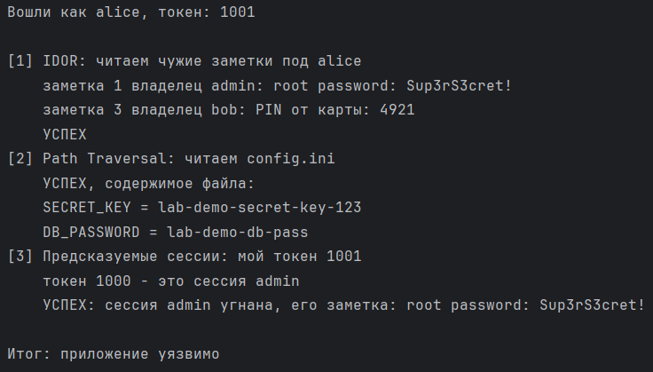
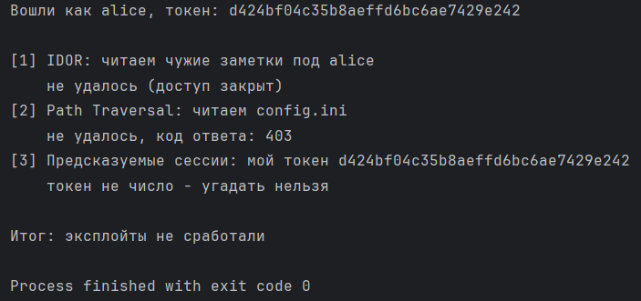
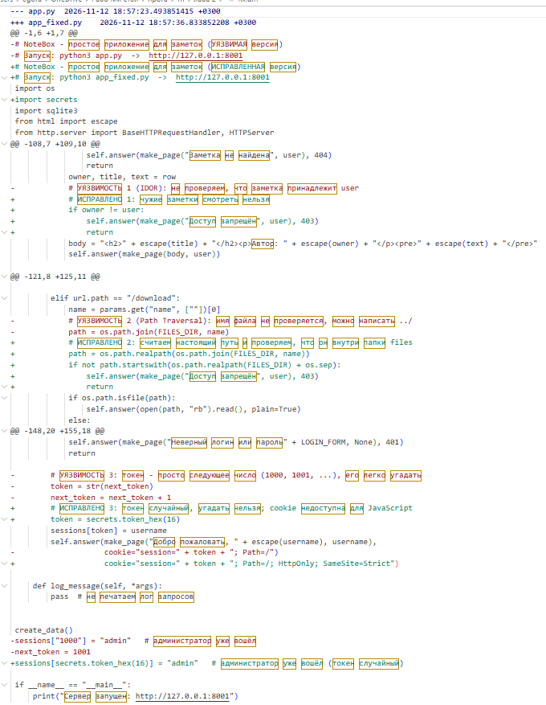

# Уязвимое веб-приложение NoteBox: эксплуатация и исправление уязвимостей

Лабораторная работа 2. Программа — учебное веб-приложение для хранения личных заметок и файлов, в которое намеренно добавлены три уязвимости из OWASP Top 10. К нему прилагаются скрипт эксплуатации этих уязвимостей и патч в формате `diff`.
### Приложение написано на стандартных модулях Python (без сторонних фреймворков), чтобы код был простым и каждую строку можно было объяснить.

## Состав проекта

| Файл | Назначение |
|------|------------|
| `app.py` | уязвимая версия веб-приложения (часть 1) |
| `exploit.py` | скрипт, эксплуатирующий уязвимости (часть 2) |
| `fix.diff` | патч, исправляющий уязвимости (часть 3) |
| `app_fixed.py` | исправленная версия приложения (результат применения патча) |

## Описание работы

1. `app.py` запускает HTTP-сервер на `http.server` по адресу `127.0.0.1:8001`. Данные хранятся в базе SQLite в памяти.
2. Функция `create_data()` создаёт таблицы `users` и `notes`, тестовых пользователей (`admin`, `alice`, `bob`), их заметки и файлы для скачивания. Секретный файл `config.ini` лежит рядом с приложением, вне папки `files/`.
3. Функция `get_user()` определяет пользователя по cookie `session`, а `make_page()` собирает HTML-страницу.
4. Класс `Handler` обрабатывает маршруты: `/login` (вход), `/notes` (список своих заметок), `/note?id=N` (просмотр заметки), `/files` и `/download?name=...` (файлы).
5. `exploit.py` входит в приложение под обычным пользователем `alice` и по очереди применяет три атаки. Функции `attack_idor()`, `attack_path_traversal()` и `attack_sessions()` выводят, что удалось получить.
6. `fix.diff` создан командой `diff -u app.py app_fixed.py` и применяется командой `patch -p0 < fix.diff`.
7. После применения патча `exploit.py` запускается повторно и ни одна атака не срабатывает.

## Реализованные уязвимости

| № | Уязвимость | Категория OWASP Top 10:2021 | Где находится |
|---|------------|-----------------------------|---------------|
| 1 | IDOR (небезопасная прямая ссылка на объект) | A01 Broken Access Control | `/note?id=N` |
| 2 | Path Traversal (обход каталога) | A01 Broken Access Control | `/download?name=...` |
| 3 | Предсказуемые токены сессий | A07 Identification and Authentication Failures | выдача cookie `session` при входе |

### 1. IDOR
**Причина:** сервер проверяет, что пользователь вошёл, но не проверяет, что заметка принадлежит ему. Номер заметки берётся из URL.
**Эксплуатация:** `alice` перебирает `id` от 1 до 10 и читает заметки `admin` (пароль root) и `bob` (PIN карты).
**Исправление:** добавлена проверка `if owner != user`, при несовпадении возвращается 403.

### 2. Path Traversal
**Причина:** имя файла из параметра `name` напрямую присоединяется к пути папки `files/`, а последовательность `../` позволяет выйти за её пределы.
**Эксплуатация:** запрос `/download?name=../config.ini` возвращает файл с секретными ключами `SECRET_KEY` и `DB_PASSWORD`.
**Исправление:** итоговый путь приводится к каноническому виду через `os.path.realpath`, и если он не лежит внутри `files/`, возвращается 403.

### 3. Предсказуемые токены сессий
**Причина:** токен сессии — это следующее число из счётчика (1000, 1001, ...), поэтому его можно угадать.
**Эксплуатация:** `alice` получает свой токен (1001), перебирает соседние значения и находит токен 1000, то есть открытую сессию `admin`. С ней становится доступна его заметка.
**Исправление:** токен генерируется через `secrets.token_hex(16)` (128 бит случайности). В cookie добавлены флаги `HttpOnly` и `SameSite=Strict`.

## Запуск

Все команды выполняются из папки проекта. Приложение слушает только `127.0.0.1` и не должно выставляться в сеть.

**Уязвимая версия и эксплойт:**

```bash
# терминал 1
python3 app.py

# терминал 2
python3 exploit.py
```

**Применение патча и повторная проверка:**

```bash
# остановить сервер (Ctrl+C), затем
patch -p0 < fix.diff
python3 app.py          # теперь это исправленная версия

# в другом терминале
python3 exploit.py
```

Исправленную версию можно запустить и без патча: `python3 app_fixed.py`.

## Результаты выполнения

### Эксплуатация уязвимой версии

Скрипт читает чужие заметки, `config.ini` и угоняет сессию администратора.



### Исправленная версия

После применения патча все три атаки завершаются неудачей (код 403, «доступ закрыт», «токен не число»).



### Патч

Фрагмент `fix.diff` с исправлениями:


